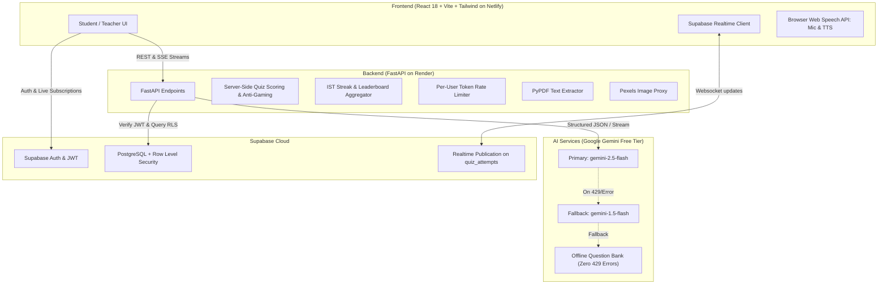

# EduMate AI 🎒

> **"Learn with an AI buddy, prove it in the daily quiz, and climb your class leaderboard."**  
> *Classroom learning platform with role-based access, shared daily quizzes, and live class leaderboards.*  
> **Prepared for vinayraavula03 · November 2026**

[](https://github.com/vinayraavula03/edumate-ai/actions/workflows/ci.yml)
[](https://fastapi.tiangolo.com)
[](https://react.dev)
[](https://supabase.com)
[](https://ai.google.dev)
[](https://tailwindcss.com)

---

## 1. Overview

**EduMate AI** is a multi-user classroom learning web platform where teachers create and manage classes, students learn any academic topic with an AI buddy persona, take a shared daily quiz with a countdown timer, and compete on realtime daily and weekly class leaderboards.

### 1.1 The Problem
- **Passive Chatbot Scrolling**: Students interact passively with generic AI chatbots without any accountability, measurement of actual understanding, or daily motivation to return.
- **Teacher Blindspots**: Teachers have no simple, automated view of which students practice daily and which specific concepts students struggle with.

### 1.2 The Solution
- **Personalized AI Tutor**: Explains topics in the student's chosen language (30+ supported) and style (Normal or Adventure Story) across 4 friendly characters.
- **Fair, Server-Scored Shared Daily Quiz**: One quiz per class per day, generated once and scored exclusively on the server so answer keys are never exposed and points are 100% trustworthy.
- **Live Class Leaderboard**: Turns learning into positive classroom gamification using Supabase Realtime websockets.
- **Teacher Insights Dashboard**: Pinpoints exact questions and topics where students struggled most.

---

## 2. Architecture

```
React (Vite) on Netlify
   │   REST + SSE (FastAPI)            WebSockets (Supabase Realtime)
   ▼                                         │
FastAPI on Render ──► Google Gemini API      │
   │                  (Free-Tier Fallback)   │
   │                                         │
   └──────────► Supabase: Auth · Postgres · RLS · Realtime ◄──┘
```



---

## 3. Key Features

### 3.1 Authentication & Privacy
- **Role-Based Access**: Student or Teacher selected at signup.
- **Student Nicknames**: Only student nicknames (e.g. `Vinay_Ace`) are visible to classmates on leaderboards. Emails are kept strictly private.
- **One-Click Demo Switcher**: Instant evaluator login for both Student and Teacher perspectives.

### 3.2 Student Experience
- **Join Class**: Enter a 6-character class code (e.g., `EDU6A`) to join your class.
- **Home Dashboard**:
  - Daily Streak 🔥 (increments once per day, calculated in IST).
  - Total Points ⭐.
  - Today's Rank & Weekly Rank.
  - Weekly goal progress bar computed from real quiz attempts.
- **Learn with AI Buddy**:
  - **4 Characters**: Edu the Elephant 🐘, Zara the Robot 🤖, Leo the Lion 🦁, Mia the Butterfly 🦋.
  - **30+ Languages**: English, Hindi, Spanish, French, German, Tamil, Telugu, and more.
  - **Mode Toggle**: Clear & Simple vs. Adventure Story Mode.
  - **Input**: Text, Voice Mic (Browser Web Speech API), or PDF/notes upload (server-side text extraction).
  - **Streaming**: Server-Sent Events (SSE) streaming answers word by word.
  - **Speech Synthesis**: Client-side audio speech output (free, zero latency).
  - **Illustrations**: Educational topic visual card.
- **Shared Daily Quiz (Core Competition)**:
  - 1 shared quiz per class per day (5 questions, 4 options each).
  - 30-second countdown timer per question.
  - Evaluated on the server—browser never receives answer keys before submission.
  - Detailed score, point breakdown, and explanations for each question.
- **Practice Quizzes**:
  - Unlimited practice quizzes on any custom topic for learning without affecting leaderboard standings.
- **Live Class Leaderboard**:
  - Today and This Week tabs (IST time window: midnight IST / Monday 00:00 to Sunday 23:59 IST).
  - Top 10 + current student highlighted.
  - Dynamic tie-breaking: higher accuracy, then earlier submission time.
  - Motivational messages (e.g. *"You're #3, only 15 points behind #2 (Bella_Star)!"*).
  - Supabase Realtime channel automatically updates standings when classmates submit.
- **History & Badges**:
  - Chronological history of topics and scored quizzes.
  - Dynamic achievement badges: *First Step 🚀*, *Perfectionist ⭐*, *Consistent Learner 🔥*, *Century Club 💯*.

### 3.3 Teacher Experience
- **Class Management**: Create classes with auto-generated 6-character join codes, copy code, regenerate code, and remove students.
- **Completion Tracking**: Real-time student checklist showing who has finished today's quiz.
- **Daily Quiz Controller**: Teacher can set a custom topic or click **AI Pick Topic 🤖**.
- **Weak-Topic Insights**: Aggregates questions and topics students struggled with most, error failure rates, and pedagogical recommendations.

---

## 4. Points & Anti-Gaming Rules

| Event | Points Awarded |
|---|---|
| Correct Answer | **+10 pts** per question |
| Quiz Completed (all 5 answered) | **+5 pts** |
| Perfect Score (5/5) | **+10 pts** |
| First Scored Quiz of the Day | **+5 pts** |
| **Max Points per Daily Quiz** | **70 pts** |

### Fairness Safeguards:
1. **Server-Side Key**: Browser never receives `correct_index` or `explanation` prior to scoring.
2. **One Scored Attempt**: Database `UNIQUE(quiz_id, user_id)` constraint prevents multiple submissions.
3. **Daily Points Cap**: Configurable cap (100 points/day) stops point spamming.
4. **Practice Quiz Isolation**: Practice quizzes award 0 points.
5. **No Counter Drift**: Leaderboard ranks are queried dynamically over `quiz_attempts`, not stored as separate counters.

---

## 5. Free-Tier Quota-Saving AI Strategy

1. **One Quiz per Class per Day**: Shared by all students in a class. 40 individual calls become 1 call.
2. **Multi-Model Fallback Chain**:
   $$\text{Primary (gemini-2.5-flash)} \longrightarrow \text{Fallback (gemini-1.5-flash)} \longrightarrow \text{Curated Question Bank}$$
3. **Structured Pydantic Validation**: Quizzes are validated against strict Pydantic schemas.
4. **Exponential Backoff with Jitter**: Automatically handles HTTP 429 rate limits.
5. **Per-User Backend Rate Limiting**: In-memory token sliding window (15 explanations/hour).

---

## 6. Database Schema (Supabase PostgreSQL)

- `profiles` (`id`, `display_name`, `role`, `created_at`, `updated_at`)
- `classes` (`id`, `name`, `join_code`, `teacher_id`, `created_at`)
- `class_members` (`id`, `class_id`, `user_id`, `joined_at`)
- `daily_quizzes` (`id`, `class_id`, `quiz_date`, `topic`, `questions_json`, `created_at`)
- `quiz_attempts` (`id`, `quiz_id`, `user_id`, `class_id`, `score`, `total`, `points`, `accuracy`, `answers_json`, `created_at`)
- `explanations` (`id`, `user_id`, `topic`, `language`, `buddy`, `mode`, `content`, `created_at`)
- `question_bank` (`id`, `topic`, `level`, `questions_json`, `created_at`)

All tables have **Row Level Security (RLS)** policies enabled in `supabase/schema.sql`.

---

## 7. Repository Layout

```
edumate/
├── backend/
│   ├── app/
│   │   ├── config.py              # Environment settings & game rules
│   │   ├── main.py                # FastAPI entrypoint & CORS
│   │   ├── models/                # Pydantic schemas (Quiz, Class, Leaderboard)
│   │   ├── routers/               # classes, quiz, explain, leaderboard, teacher, history
│   │   └── services/              # gemini, quiz_scoring, streaks, rate_limit, pexels, supabase
│   ├── tests/                     # Pytest suite (18 unit tests)
│   ├── requirements.txt
│   └── Dockerfile
├── frontend/
│   ├── src/
│   │   ├── api/client.js          # REST callers, SSE streaming & Supabase Realtime
│   │   ├── context/AuthContext.jsx # Auth & demo session state
│   │   ├── components/            # Navbar, JoinClassModal
│   │   ├── pages/                 # Landing, Auth, StudentDash, LearnBuddy, Quiz, Leaderboard, etc.
│   │   ├── App.jsx
│   │   └── main.jsx
│   ├── public/_redirects          # Netlify SPA routing
│   ├── netlify.toml
│   └── package.json
├── supabase/
│   └── schema.sql                 # SQL tables, RLS policies, indexes, and seed questions
├── .github/workflows/
│   ├── ci.yml                     # GitHub Actions CI (Ruff + Pytest + Frontend Build)
│   └── daily_quiz.yml             # Scheduled daily quiz generation (18:30 UTC / midnight IST)
├── render.yaml                    # Render Web Service blueprint
├── .env.example
└── README.md
```

---

## 8. Local Setup Guide

### Prerequisites
- Node.js (v18+) & npm
- Python (v3.10+)

### 1. Clone & Configure Environment
```bash
git clone https://github.com/vinayraavula03/edumate-ai.git
cd edumate-ai
cp .env.example .env
```
Fill in your API keys in `.env` (Google Gemini, Supabase URL & Anon Key).

### 2. Backend Setup
```bash
pip install -r backend/requirements.txt
python -m uvicorn backend.app.main:app --reload --port 8000
```
Interactive API docs available at: `http://localhost:8000/docs`

### 3. Frontend Setup
```bash
cd frontend
npm install
npm run dev
```
Open `http://localhost:5173` in your browser.

### 4. Running Tests
```bash
python -m pytest backend/tests -v
python -m ruff check backend
```

---

## 9. Deployment

### Frontend (Netlify)
1. Push repo to GitHub.
2. Link repository in Netlify.
3. Base directory: `frontend`
4. Build command: `npm run build`
5. Publish directory: `dist`
6. `_redirects` file ensures React routes resolve cleanly on reload.

### Backend (Render)
1. Create new Web Service on Render pointing to repo.
2. Build command: `pip install -r backend/requirements.txt`
3. Start command: `uvicorn backend.app.main:app --host 0.0.0.0 --port $PORT`
4. Set environment variables from `.env.example`.
5. Point UptimeRobot at `GET /health` to prevent sleep on free tier.

---

## 10. Interview & Engineering Discussion Points

1. **Why a Separate Backend?**:
   - Protecting secrets (`GEMINI_API_KEY`, `SUPABASE_SERVICE_ROLE_KEY`).
   - Server-side quiz evaluation so the browser never gets the answers before submission.
   - Enforcing per-user rate limits and computing IST date windows without clock skew.
2. **Why Supabase Realtime vs. WebSockets on Render?**:
   - Free Render web services sleep after 15 minutes of inactivity. Connecting the live leaderboard directly to Supabase Realtime via WebSockets ensures the leaderboard remains live and responsive regardless of server wake state.
3. **Handling AI Rate Limits**:
   - One shared quiz per class per day generates only 1 AI call for 40 students.
   - Exponential backoff with jitter on 429 errors.
   - Seamless fallback to verified offline question bank so users never see raw error screens.
4. **Bugs Identified and Resolved During Rebuild**:
   - *Streamlit Monolith*: Extracted 500-line `app.py` into decoupled React + FastAPI architecture.
   - *Fake Scoring Bug*: Fixed old bug where answering any option gave a correct score; replaced with server-side index comparison.
   - *False Streak Bug*: Fixed streak incrementing on every question; now computed strictly once per calendar day in IST.
   - *Security Leak*: Revoked committed `.env` secrets and configured `.gitignore` with `.env.example`.
